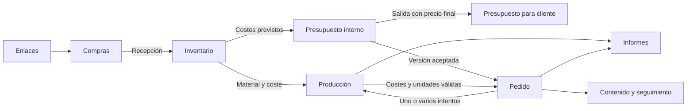

# Producto y módulos

Estado: diseño propuesto el 15 de octubre de 2026. Las funciones futuras se describen como objetivos, no como capacidades de la APK actual.

## Objetivo

Un espacio personal para preparar la impresora, organizar el taller y gestionar encargos, con datos que puedan relacionarse sin depender de que el USB esté conectado. La app debe responder a preguntas concretas: qué tengo, qué estoy haciendo, cuánto cuesta, cuánto he presupuestado, qué queda por cobrar y qué debo hacer después.

## Navegación

Agrupar los módulos para evitar una barra con demasiadas opciones:

- **Inicio:** próximos trabajos, pedidos próximos a entregar y seguimientos pendientes. Se añade cuando existan esos datos; inicialmente se mantiene acceso directo a la impresora.
- **Impresora:** Control, Cama, Ajustes y Registro actuales.
- **Taller:** Producción, Inventario e Informes.
- **Negocio:** Presupuestos, Pedidos y clientes, Compras y enlaces, Contenido y seguimiento.
- **Mejoras:** ideas, funciones y fallos de la app.

Cada sección conserva su pantalla y sus filtros al cambiar de área. El estado USB permanece accesible desde cualquier pantalla; cambiar de módulo no abre, cierra ni reinicia el puerto. Los módulos sin implementar no presentan cifras de ejemplo como si fueran datos del usuario.

## M1. Impresora

Responsabilidad: comunicación y estado físico de la máquina. Mantener el control actual, calibración, mallas, diagnóstico y protecciones de movimiento. Conservar el tamaño de malla comunicado por Marlin, sea o no 11 × 11.

Evolución posterior: observación de trabajos SD, mantenimiento, horas registradas de producción y avisos de revisión. El tiempo conectado por USB no se contabiliza como tiempo de impresión. Medir la cama tampoco crea una impresión ni un ingreso.

## M2. Producción e informes

Responsabilidad: registrar qué se fabrica y convertirlo en datos de uso y coste.

- Trabajos manuales para las impresiones SD: nombre, impresora, origen, fecha, tiempo estimado y real conocido, piezas previstas y obtenidas, material, incidencias y resultado.
- Distinguir un intento de impresión de un pedido. Un encargo puede requerir varios trabajos y reintentos; una calibración o un prototipo puede no tener cliente.
- Resultado de cada intento: pendiente, en curso, pausado, terminado, fallido o cancelado. Si se pierde observación, mostrar «seguimiento interrumpido» hasta confirmar el resultado.
- Registrar soportes, purga, descartes y fallos sin ocultar sus costes. Confirmar calidad y unidades válidas al cerrar el trabajo.
- Coste por intento y por pedido, material consumido, horas, incidencias y mantenimiento.
- Informes por periodo: trabajos, unidades válidas, fallos, tiempo registrado, gramos, costes, ventas registradas, cobros y margen sobre costes registrados. Todos deben permitir consultar los registros de origen.
- Mostrar cobertura: trabajos con coste completo, datos estimados y datos pendientes. «Sin registrar» no equivale a cero.

Los informes resumen información de los otros módulos; no mantienen una segunda contabilidad editable.

## M3. Pedidos y clientes

Responsabilidad: gestionar el compromiso comercial y su seguimiento. «CRM» describe la parte de clientes; aquí también hacen falta pedidos, cobros y entrega.

- Contacto mínimo: nombre o alias, canal, identificador o teléfono opcional y notas.
- Pedido con referencia, concepto, cantidades, personalización, precio acordado, fecha objetivo, entrega y enlaces a presupuesto y producción.
- Estados comerciales: consulta, presupuesto enviado, confirmado, en preparación, listo, entregado o cancelado. No deducir «pagado» de «entregado» ni «entregado» de una impresión terminada.
- Cobros separados: anticipo, pagos parciales, saldo pendiente y devoluciones. Registrar una venta no demuestra que se haya cobrado.
- Historial manual de interacciones: canal, fecha, resumen, siguiente acción y fecha de seguimiento.
- Plantillas de respuesta editables y apertura voluntaria de Instagram/WhatsApp cuando haya un destino válido. El usuario revisa y envía el mensaje en la aplicación correspondiente.

La primera versión no lee conversaciones ni publica o envía mensajes automáticamente.

## M4. Inventario

Responsabilidad: saber qué existe, dónde está, cuánto queda y cuál es su origen.

- Filamentos por bobina o lote: material, marca, color, diámetro opcional, gramos iniciales, peso de la bobina vacía si se conoce, coste y ubicación.
- Consumibles y embalaje por unidad. Repuestos y herramientas identificados como tales, sin imputar su precio completo a cada impresión.
- Movimientos con fecha y motivo: alta inicial, recepción de compra, consumo, ajuste por pesaje, devolución y baja.
- Existencias calculadas a partir de movimientos. Distinguir peso medido y restante estimado por consumo.
- Umbral de reposición configurable; no afirmar disponibilidad exacta cuando falten movimientos.
- Un intento fallido puede consumir material. Cancelar un pedido no devuelve físicamente ese material.

Primera entrega: bobinas, consumibles básicos y movimientos. Reservas, lotes complejos y valoración avanzada quedan para ampliaciones posteriores.

## M5. Compras y enlaces

Responsabilidad: pasar de una referencia guardada a una compra real sin confundir ambas.

- Guardar enlaces de proveedores, materiales, repuestos, herramientas, modelos e inspiración; añadir etiquetas, notas y relación opcional con un producto.
- Precio visto opcional, moneda y fecha. Un precio guardado no se presenta como precio actual verificado.
- Lista de deseos o pendientes de comprar, separada de compras realizadas.
- Compra con proveedor, líneas, cantidades, importes realmente pagados, portes/descuentos y estado de recepción.
- Recibir una compra crea los movimientos de inventario una sola vez. Registrar el enlace o marcar «comprado» no implica recibir existencias.
- Relacionar justificantes cuando se incorpore el soporte de adjuntos.

La primera versión guarda información manual. No compara precios en tiendas, hace pedidos ni paga automáticamente.

## M6. Presupuestos

Responsabilidad: preparar un precio antes de comprometer el pedido y conservar lo que se ofreció.

**Vista interna:** cantidades, gramos, soportes/merma prevista, horas de máquina, energía, trabajo manual, acabados, embalaje, transporte, comisiones previstas, contingencia opcional, coste total, precio propuesto y margen. Cada partida conserva su origen y si es estimada o conocida. Las partidas desconocidas aparecen pendientes y afectan a la indicación de completitud.

**Salida para cliente:** por defecto concepto o referencia y **precio final total**. Descripción, cantidad y plazo se añaden solo si se decide mostrarlos. Nunca incluye gramos, horas internas, coste de compra, proveedores, margen, notas privadas ni desgloses de coste. El cliente recibe un documento o texto preparado, no acceso a la app.

- Guardar borradores y versiones enviadas. Cambiar el precio de una bobina mañana no reescribe un presupuesto ya enviado.
- Estados: borrador, enviado, aceptado, rechazado, caducado o sustituido por otra versión.
- La aceptación puede crear un pedido conservando el vínculo con la versión exacta, sin duplicarlo al repetir la acción.
- Comparar presupuesto previsto con costes reales cuando exista producción.
- Los presupuestos pueden existir antes de registrar al cliente con todos sus datos.

La especificación detallada está en [F04](features/F04-PRESUPUESTOS.md). Exportación PDF para cliente y texto para copiar; no se envía nada sin una acción explícita del usuario.

## M7. Mejoras

Responsabilidad: capturar y organizar la evolución de la propia app, sin abandonar el trabajo del taller.

- Añadir una idea, pedir una función o registrar un fallo desde cualquier sección.
- Título, descripción, módulo, prioridad y estado; fecha automática.
- En un fallo, pasos, resultado esperado y observado; versión de la app y diagnóstico opcional con vista previa.
- Buscar y filtrar; marcar duplicados, mantener notas de seguimiento y anotar la versión que lo resuelve.
- «Por verificar» es distinto de «Hecho»: una corrección compilada no demuestra que el fallo físico se haya resuelto.
- Información local incluida en la copia de seguridad; sin crear incidencias públicas ni enviar registros automáticamente.

## Contenido y seguimiento comercial

Ampliación del módulo de negocio, separada del resultado de producción:

- Asociar una tarea de contenido a un producto y opcionalmente a un pedido, sin necesidad de exponer datos del cliente.
- Estados: idea, pendiente de fotos, preparado y publicado; fecha y enlace al publicar.
- Marcar si hay permiso para usar imágenes cuando aparezca un encargo personalizado; decisión manual.
- Mantener mensajes y seguimientos como tareas distintas de las publicaciones. Publicar en Instagram no marca un pedido como entregado.
- Preparar textos y conservar referencias. La integración automática con redes se estudia aparte si llega a ser necesaria.

## Relaciones principales

Las flechas describen relaciones de negocio, no dependencias directas entre pantallas ni automatismos ya implementados.

## Recorrido inicial previsto

1. Registrar una bobina y su coste conocido.
2. Preparar un presupuesto interno con consumos estimados y obtener la salida con precio final para el cliente.
3. Registrar aceptación y crear el pedido.
4. Iniciar físicamente la impresión desde SD y registrar el intento en la tablet.
5. Al terminar, confirmar resultado, tiempo y material conocidos; conservar también los intentos fallidos.
6. Revisar coste acumulado del pedido, entrega y cobros.
7. Consultar informes y preparar contenido o seguimiento si corresponde.

Cada paso es utilizable de forma independiente: se puede registrar una prueba sin pedido o un pedido con precio ya acordado sin presupuesto previo.

## Ampliaciones que conviene reservar

Catálogo de productos con variantes y fotos; mantenimiento por horas registradas; importación de estimaciones del laminador; producción de varios pedidos en una misma placa con reparto explícito; reservas de stock; recordatorios locales; plantillas de presupuestos y respuestas; sincronización con móvil o varios usuarios. Se incorporan solo cuando una necesidad concreta justifique su coste.
